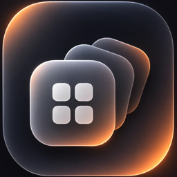
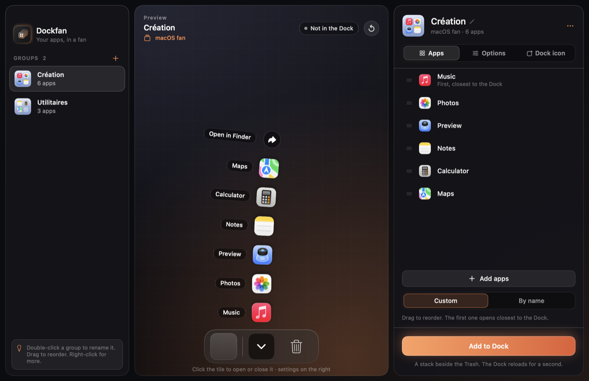
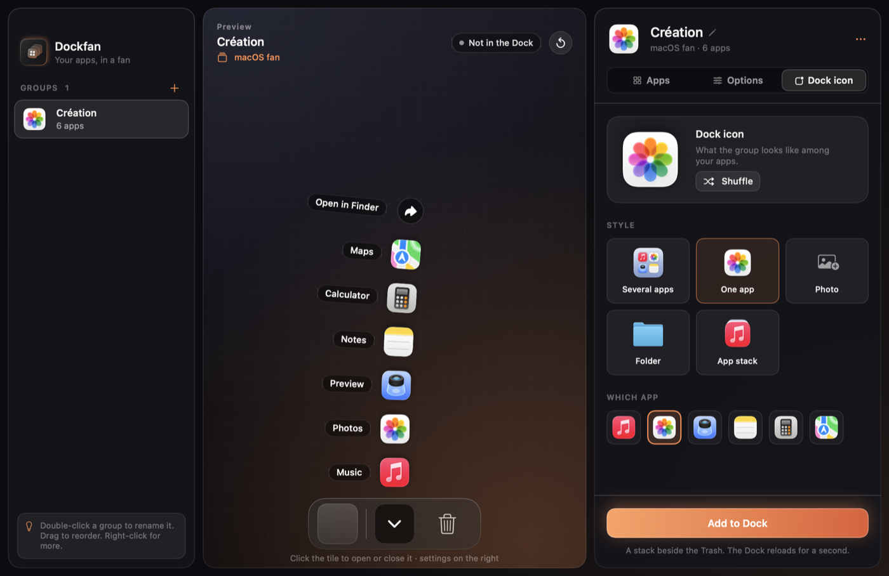
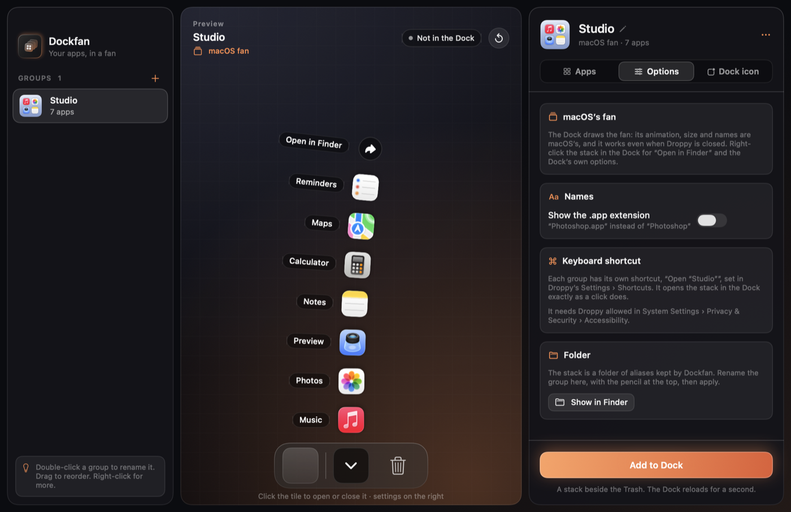

# Dockfan



Un droplet macOS pour [Droppy](https://getdroppy.app/) qui regroupe plusieurs apps dans une seule tuile du Dock. Un clic, et les apps s'ouvrent en éventail, avec l'animation native de macOS.

[Télécharger la dernière version](https://github.com/Nicolasdellim/dockfan/releases/latest) · [Signaler un problème](https://github.com/Nicolasdellim/dockfan/issues)

Version actuelle : **1.0.0**.



## Ce que fait Dockfan

Chaque groupe devient une vraie pile du Dock, à côté de la corbeille, affichée en éventail. Le comportement est celui de macOS : animation, fermeture, glisser-déposer. Une fois la pile placée, elle fonctionne même si Droppy est quitté.

Dockfan ajoute les réglages que macOS ne propose pas :

- **Icône dans le Dock** : plusieurs apps sur un fond de couleur, l'icône d'une seule app, une photo, un dossier ou la pile d'apps classique.
- **Ordre des apps** : glisser pour réordonner (la première s'ouvre au plus près du Dock), ou tri par nom.
- **Noms** : avec ou sans l'extension « .app ».
- **Renommer** un groupe d'un double-clic, ce qui renomme aussi sa pile dans le Dock.
- **Afficher dans le Finder** le dossier du groupe.
- **Raccourci clavier par groupe**, qui ouvre la vraie pile du Dock.
- **Suggestions** de groupes à partir des suites déjà installées (Adobe, Microsoft Office, iWork, navigateurs, utilitaires).



Limites : l'éventail est celui de macOS. La taille des icônes, l'espacement et l'affichage des noms dans l'éventail ne sont pas réglables.

## Installation

1. Télécharger **Dockfan-1.0.0.droplet.zip** depuis les [releases](https://github.com/Nicolasdellim/dockfan/releases/latest), puis décompresser l'archive.
2. Dans Droppy → Réglages → Droplet Store → Local droplets, importer `Dockfan.droplet` et approuver le build.
3. Quitter puis relancer Droppy si une ancienne version était déjà chargée.
4. Pour les raccourcis clavier : autoriser Droppy dans Réglages Système → Confidentialité et sécurité → Accessibilité.

## Utilisation

1. Dans Droppy → Réglages → Dockfan, cliquer sur **Ouvrir Dockfan**.
2. Cliquer sur **Créer un groupe**, ou partir d'une suggestion.
3. Ajouter des apps avec **Ajouter des apps** ou en les glissant depuis le Finder, puis les réordonner.
4. Choisir l'icône dans l'onglet **Icône**, et le reste dans **Options**.
5. Cliquer sur **Ajouter au Dock**. Le Dock se recharge environ une seconde.

Les apps ajoutées, retirées ou réordonnées apparaissent tout de suite dans une pile déjà placée. Un nouveau nom ou une nouvelle icône s'applique avec **Appliquer au Dock**. Pour retirer une pile, utiliser **Retirer du Dock** ou la sortir du Dock comme d'habitude.



## Confidentialité

- **global-shortcuts** : raccourcis clavier optionnels, un par groupe.
- **accessibility** : utilisée seulement par ces raccourcis, pour ouvrir la pile du Dock correspondante.
- Les groupes sont stockés dans le dossier de Dockfan, dans le conteneur de Droppy : un fichier `groups.json` et un dossier d'alias Finder par groupe, que le Dock affiche.
- Pour placer une pile, Dockfan modifie les préférences du Dock (`com.apple.dock`, `persistent-others`) puis relance le Dock. Une copie de ces préférences est gardée avant chaque changement (les dix dernières).
- Aucun accès réseau. Rien ne quitte le Mac.

## Construction

macOS 14+, Xcode 26 / Swift 6.2+, Droppy 15.3+, DroppyKit 1.22+.

Cloner https://gitlab.com/droppyformac1/droppykit puis, depuis ce dossier :

```sh
/path/to/droppykit/Scripts/droppykit build
/path/to/droppykit/Scripts/droppykit validate
```

Le bundle universel Apple Silicon / Intel est lié au framework DroppyKit fourni par Droppy. Interface en anglais et en français.

## Contribuer

Les signalements et propositions sont les bienvenus. Pour un bug, indiquez les versions de macOS et de Droppy, les étapes pour le reproduire et le résultat attendu. Les modifications de code peuvent être proposées par pull request.

## Contributeurs

- **Nicolas Delli Muti** ([Vision Studio](https://vision-studio.be)) : idée, design, retours et validation.
- **Claude Code (Anthropic)** : développement, tests et documentation, en collaboration avec Nicolas.

## Licence

[MIT](LICENSE). Droppy et DroppyKit sont des projets distincts, soumis à leurs propres licences. Ce projet communautaire est indépendant de Droppy.
